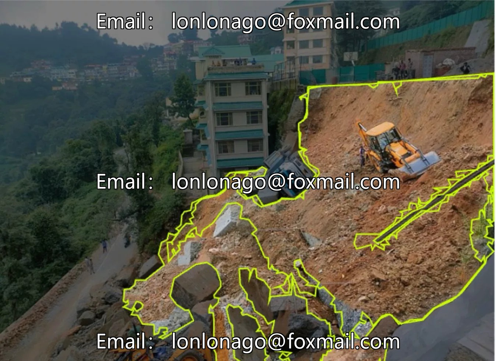
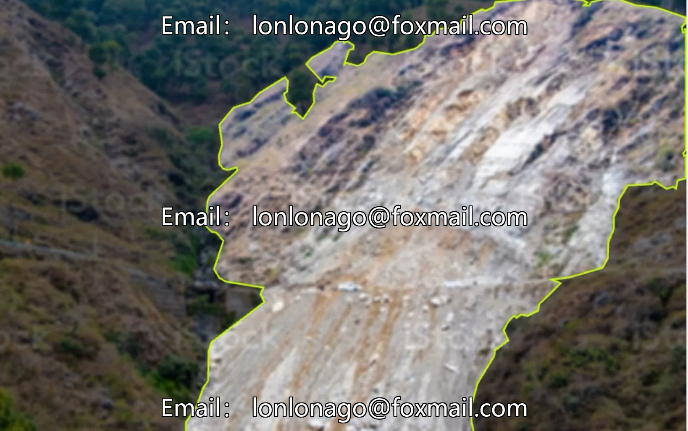
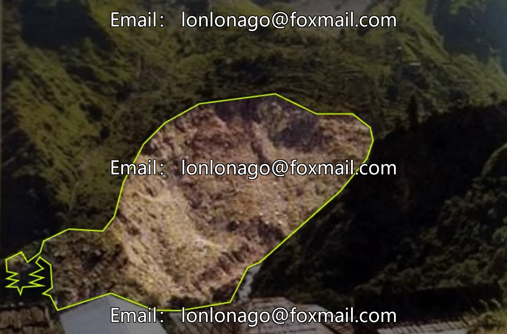
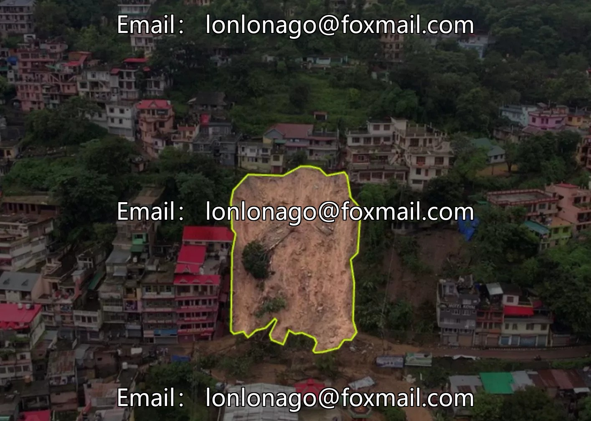
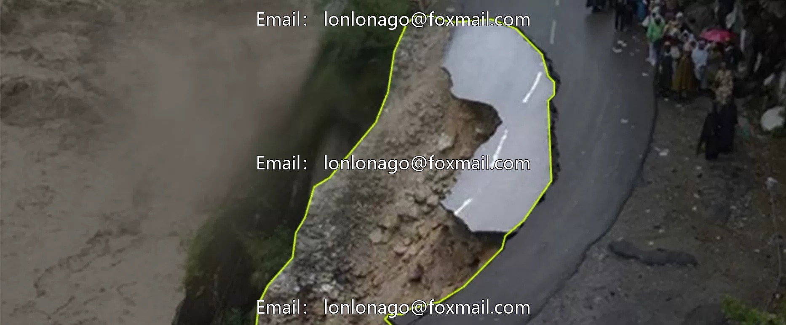
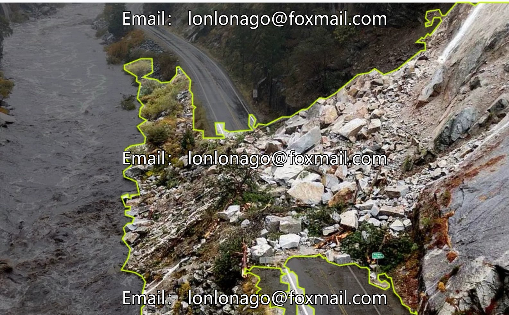

# Drone aerial photography inspection dataset, including drones for landslides, mudslides, rockfalls, etc.

## Body

Drone aerial photography inspection dataset, including drone scenarios such as mountain landslides, mudslides, and rockfalls, suitable for applications in geological disaster monitoring, risk assessment, and disaster early warning.

The dataset consists of 745 labeled images, divided into three categories: landslides, objects, and rocks. It is accompanied by three sub-datasets, primarily in image file format, compatible with the training needs of mainstream computer vision models.

The data volume is sufficient, with high segmentation precision, suitable for model training and instance segmentation tasks, and enhances the accuracy of disaster identification and early warning.

Virtual materials, once sold, are non-refundable.
Interested friends, click "I want" to proceed.

## Images

## Payment

Here is a pay link on Stripe ( https://buy.stripe.com/3cs8yP7sY87d0vu9AB ). Please contact me lonlonago@foxmail.com after funding $89, and I will send you a complete data files , thank you!

